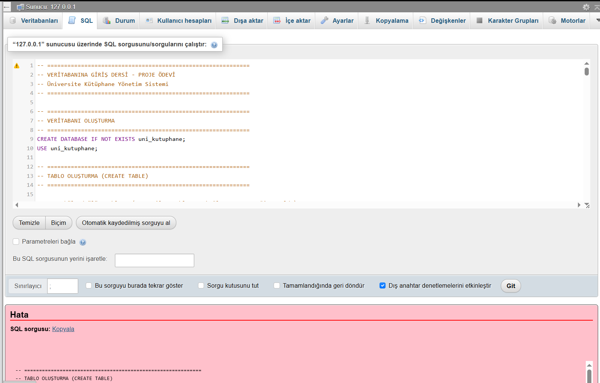

# 🗄️ Üniversite Kütüphane Yönetim Sistemi — SQL Veritabanı Projesi

**Üçüncü Normal Form (3NF)** kurallarına uygun olarak tasarlanmış, tetikleyiciler (`TRIGGER`), saklı yordamlar (`STORED PROCEDURE`) ve analitik sorgular içeren ilişkisel MySQL veritabanı projesi.

## 📐 Veritabanı Mimarisi (9 İlişkisel Tablo)

| Tablo | Açıklama |
|---|---|
| `bolumler` | Fakülte ve bölüm bilgileri (3NF gereği öğrencilerden ayrıştırılmıştır) |
| `ogrenciler` | Öğrenci kayıtları (`bolumler` ile ilişkili) |
| `yazarlar` | Kitap yazarları |
| `yayinevleri` | Yayınevi bilgileri |
| `kategoriler` | Kitap tür ve kategorileri |
| `kitaplar` | Kitap üst verileri (`yayinevleri` ve `kategoriler` ile ilişkili) |
| `kitap_yazar` | Kitap–Yazar çoktan çoğa (`N:M`) ilişki ara tablosu (bileşik birincil anahtar) |
| `kitap_kopyalari` | Fiziksel nüsha ve müsaitlik durumu takibi |
| `odunc_islemleri` | Ödünç alma, son teslim ve iade işlemleri |



## ⚙️ Otomasyon (Trigger & Stored Procedure)

- **`sp_odunc_ver` & `sp_iade_al`:** Ödünç verme ve iade alma işlemlerini iş kurallarına göre yürüten saklı yordamlar.
- **`trg_odunc_sonrasi_kopya_guncelle` & `trg_iade_sonrasi_kopya_guncelle`:** Ödünç ve iade işlemlerinden sonra kitap kopyasının müsaitlik durumunu otomatik güncelleyen tetikleyiciler.

## 🚀 Kurulum

MySQL 8+ veya MariaDB (XAMPP / phpMyAdmin / MySQL Workbench) üzerinde:

```sql
SOURCE kutuphane.sql;
```

## 👤 Geliştirici

**Semih Berke Kolatan** — Kapadokya Üniversitesi, Bilişim Sistemleri ve Teknolojileri  
[GitHub](https://github.com/semihberkekolatan) · [LinkedIn](https://www.linkedin.com/in/semihberkekolatan)
